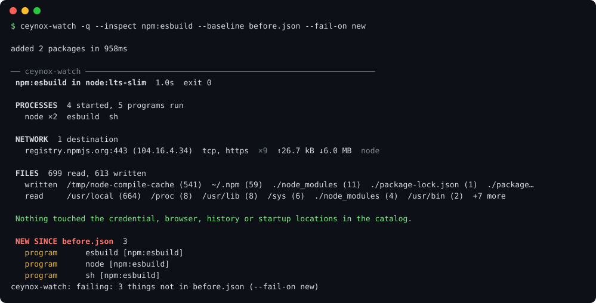

<p align="center">
  <a href="https://ceynovahq.com">
    <picture>
      <source media="(prefers-color-scheme: dark)" srcset="docs/brand/mark-white.svg">
      
    </picture>
  </a>
</p>

<h1 align="center">ceynox-watch</h1>

<p align="center">
  <b>See what a command really does on your machine.</b><br>
  Every program it starts, every host it talks to, every credential it touches.<br>
  For package installs, build scripts and AI coding agents.
</p>

<p align="center">
  <a href="https://github.com/CeyNova-Labs/ceynox-watch/actions/workflows/ci.yml"></a>
  <a href="https://github.com/CeyNova-Labs/ceynox-watch/releases/latest"></a>
  <a href="https://scorecard.dev/viewer/?uri=github.com/CeyNova-Labs/ceynox-watch"></a>
  <a href="https://www.bestpractices.dev/projects/16928"></a>
  <a href="LICENSE"></a>
  
  
</p>

Put it in front of `npm install`, `pip install`, a build script, or an AI coding agent:

<p align="center">
  
</p>

Real output, from Linux. The package is [`demo/sneaky-pip`](demo/sneaky-pip), a harmless stand-in. `pip` itself printed nothing about any of this.

```sh
brew install ceynova-labs/tap/ceynox-watch
ceynox-watch -- npm install
```

> **ceynox-watch shows you what happened. [CeyNox Security](https://ceynovahq.com) stops it.**
> The free, open-source viewer from the team that builds CeyNox Security. [More below.](#ceynox-security)

> [!NOTE]
> It observes. It does not block anything or decide what is malicious. It is also new: read [Maturity](#maturity) before you trust it.

## Contents

- [Why](#why)
- [What it does](#what-it-does)
- [Usage](#usage): [watch](#watch), [inspect a package](#inspect-a-package-first), [compare](#compare-with-last-time), [CI](#in-ci), [share](#share-a-run)
- [What is flagged](#what-is-flagged)
- [Linux and macOS](#linux-and-macos)
- [Install](#install)
- [How it compares](#how-it-compares)
- [How it works](#how-it-works)
- [Security of the tool itself](#security-of-the-tool-itself)
- [Limits](#limits)
- [Maturity](#maturity)

## Why

Installing a package runs its code. So does an AI agent working in your repository. The tools to see what that code does have existed for years, and almost nobody uses them for this, because the answer is buried in thousands of system calls.

ceynox-watch traces nothing that could not be traced before. It makes the check one command, and answers the question as asked: which package's code read your credentials, where it connected, and whether that is new.

## What it does

| | |
|---|---|
| [**Watch**](#watch) a command and everything it starts | `ceynox-watch -- npm install` |
| [**Watch an AI agent**](#watch) that is already running | `ceynox-watch --pid "$(pgrep -n claude)"` |
| [**Inspect**](#inspect-a-package-first) a package in a throwaway container | `ceynox-watch --inspect npm:some-package` |
| [**Compare two versions**](#inspect-a-package-first) of a package | `ceynox-watch --inspect npm:pkg@2.0.0 --against npm:pkg@1.9.0` |
| [**Inspect a lockfile**](#inspect-a-package-first): which dependencies run code | `ceynox-watch --inspect ./package-lock.json` |
| [**Compare**](#compare-with-last-time) an install with last time | `ceynox-watch --baseline install.json -- npm ci` |
| [**Fail a build**](#in-ci) when an install does something new | `uses: CeyNova-Labs/ceynox-watch@v0.2.4` |
| [**Share**](#share-a-run) a run as HTML or Markdown | `ceynox-watch --report run.html -- make` |

## Usage

### Watch

```sh
ceynox-watch -- <command> [args...]      # a command, and everything it starts
ceynox-watch --pid <pid>[,<pid>...]      # Linux: processes already running
ceynox-watch --all                       # Linux: the whole machine
```

A full-screen program leaves no room for live output. Run it quietly in one terminal and follow along in another:

```sh
ceynox-watch -q --json /tmp/session.jsonl -- claude     # terminal 1
ceynox-watch --view /tmp/session.jsonl --follow         # terminal 2
```

Each line names the process and the package it runs for: `[npm:…]`, `[pypi:…]`, `[gem:…]`, `[crate:…]`, and `[npx:…]` or `[uvx:…]` for a package fetched and run in one go.

### Inspect a package first

```sh
ceynox-watch --inspect npm:some-package@1.2.3
ceynox-watch --inspect pypi:some-package -- python -c 'import some_package'
```

<p align="center">
  
</p>

The install runs in a throwaway Docker container, as an unprivileged user with an empty home, and you get the usual record. A command after `--` runs in the same container once the install is done. It works from macOS too, with full Linux detail.

Two more things it can install:

```sh
ceynox-watch --inspect npm:some-package@2.0.0 --against npm:some-package@1.9.0
ceynox-watch --inspect ./package-lock.json          # or ./requirements.txt
```

`--against` installs the other version too and lists only what the inspected one does that it does not: the question a dependency update raises. A lockfile is installed whole, and the summary says which of its packages ran code of their own.

[`docs/gallery`](docs/gallery) has the records of a few well-known packages, to show what ordinary looks like.

### Compare with last time

```sh
ceynox-watch --write-baseline install.json -- npm ci        # once
ceynox-watch --baseline install.json -- npm ci              # every time after
```

<p align="center">
  
</p>

A baseline is a small JSON file you can commit. Later runs list what they did that it does not have: a new program, host, credential read or place written. `--fail-on new` turns that into exit status 3.

### In CI

```yaml
- uses: CeyNova-Labs/ceynox-watch@v0.2.4
  with:
    run: npm ci
    baseline: .github/ceynox-watch.json
    fail-on: new
```

The report goes to the job summary. A dependency update that changes what the install does fails the check on the pull request that causes it.

### Share a run

```sh
ceynox-watch --report run.html -- npm install        # or run.md
```

<p align="center">
  
</p>

One self-contained file. [docs/usage.md](docs/usage.md) has every option, the Action's inputs, exit statuses and the JSON format.

## What is flagged

Opens and connections are checked against a catalog in [`classify.rs`](crates/ceynox-watch/src/classify.rs):

| Flagged | Covers |
|---|---|
| **Credentials** | SSH keys, cloud credentials, registry tokens, Git and GitHub credentials, AI tool tokens, password stores, wallets, `.env` files, another process's environment |
| **Browser data** | saved logins, cookies, extension storage |
| **History** | shell and REPL history |
| **Persistence** | writes to shell startup files, `authorized_keys`, Git hooks, systemd units, cron, launch agents, and AI coding agents' settings and MCP server lists |
| **Control** | the cloud metadata service, the container runtime socket, the SSH and GPG agents |
| **Drop-off points** | paste sites, file drops, chat webhooks, request catchers, tunnels, dynamic DNS hosts |

Listing a folder secrets live in (`~/.ssh`, `~/.aws`) is flagged too. On Linux, a connection that sends more than 100 kB gets a line of its own. Adding a location is a one-line change, and additions are welcome.

## Linux and macOS

| | Linux | macOS |
|---|---|---|
| Needs | root, through `sudo` | nothing: no root, nothing installed |
| Watch a command | yes | yes |
| Attach to running processes, or the whole machine | yes | no |
| Programs started | all, with arguments | all; arguments missing for very short-lived ones |
| Files read | all | those in the catalog (`-v` for all) |
| Files written | all | all |
| Network | address, port, protocol, host name | port only; with `--hosts` (uses `sudo`), the rest |
| Bytes sent and received | yes, for TCP | no |
| Processes ending | yes | no |
| Baselines, reports, `--fail-on` | yes | yes |
| `--inspect` | yes, with Docker | yes, with Docker |
| Programs that sandbox themselves | work | fail to start their sandbox |

> [!IMPORTANT]
> The last row matters. macOS does not allow a sandbox inside a sandbox, so browsers and AI agents that sandbox their own commands cannot do so under ceynox-watch.

## Install

```sh
brew install ceynova-labs/tap/ceynox-watch
```

Or take the archive for your system from the [releases page](https://github.com/CeyNova-Labs/ceynox-watch/releases) and put `ceynox-watch` on your `PATH`. Each release has checksums and signed build provenance:

```sh
gh attestation verify ceynox-watch-*.tar.gz --repo CeyNova-Labs/ceynox-watch
```

- **Linux, x86-64:** run on kernels from 5.14 up. Needs BTF (`/sys/kernel/btf/vmlinux` exists).
- **Linux, arm64:** a newer kernel, built with function tracing. 6.8 works, 6.1 does not. [docs/kernels.md](docs/kernels.md) lists what has been run.
- **macOS:** Apple silicon or Intel. The binary is not signed by Apple; if you download it with a browser, clear the quarantine mark once with `xattr -d com.apple.quarantine ./ceynox-watch`.
- **From source:** see [CONTRIBUTING.md](CONTRIBUTING.md).

## How it compares

None of the mechanisms are new. If strace, bpftrace, Tetragon, Falco, Tracee, Harden-Runner, OpenSSF Package Analysis or Socket Firewall already answers your question, use it. [docs/comparison.md](docs/comparison.md) says when each is the better choice, and measures ceynox-watch against strace.

What ceynox-watch adds is what you would otherwise build on top of them:

- **Attribution to a package,** not to a process id.
- **A catalog** of locations that matter, so the few lines worth reading are not lost among thousands.
- **A comparison with last time,** and in CI a failing check.
- **Somewhere safe to try a package first.**
- **macOS,** without root and without installing anything.
- **No setup:** no policy, no daemon, no cluster.

An expert with `strace` and a script can do most of this and does not need ceynox-watch. It is for everyone who is not going to.

## How it works

- **Linux:** eight small eBPF programs, written in Rust, record process starts, file opens and connections. They only observe.
- **macOS:** the command runs under the system sandbox with a profile that allows everything and reports what happens. No root, no kernel extension.
- **Privileges:** on Linux the part that needs root is a separate helper that drops back to your user after loading. Your command never runs as root.

[docs/architecture.md](docs/architecture.md) has the detail, including the design choices that look odd and why they were made.

## Security of the tool itself

- **Root is used briefly.** The Linux helper loads the kernel programs, then becomes you again and keeps one capability. Tests check this on every run. macOS uses no root. `--all` is the exception.
- **No `unsafe` in user space.** The kernel programs need it; every use states why, and the kernel's verifier checks them anyway.
- **Input is untrusted.** Parsers are bounds-checked, and three of the four that read outside input are fuzzed on every change. Everything a watched process controls is stripped of terminal control sequences before printing.
- **Nothing leaves your machine.** No telemetry, no update check.
- **Few dependencies,** checked in CI against known advisories.

Report a vulnerability through [SECURITY.md](SECURITY.md).

## Limits

- **It is a record, not a sandbox.** By the time you read that a key was opened, it was opened.
- **It reports opens, not contents.** You see where a connection went and how much it carried, never what was in it.
- **It does not follow work handed to a running service,** such as the Docker daemon.
- **`--inspect` uses an empty container that shares your kernel.** A package that only acts when it finds credentials shows less there, and a container is not a virtual machine.
- **A process running as root can interfere** with any tracing tool, this one included.

[docs/limits.md](docs/limits.md) has the full list.

## Maturity

- **New.** First released in November 2026, with few users so far.
- **One team, no outside review.** It has not had an independent security audit.
- **Written with substantial AI assistance.** What checks it: tests that run real commands on a real kernel on every change, and fuzzing.
- **Run on a dozen systems,** listed with results in [docs/kernels.md](docs/kernels.md), including three arm64 kernels it does not start on. Not run on Intel Macs.

Try it first on a machine you can afford to, and [tell us](https://github.com/CeyNova-Labs/ceynox-watch/issues) what breaks. An outside review is what this project most lacks.

## License

The program is [Apache-2.0](LICENSE). The kernel programs are MIT or GPL-2.0, as the kernel requires; the shared record layouts are MIT or Apache-2.0. The CeyNox and CeyNova Labs names and logos are trademarks of CeyNova Labs LLC.

## CeyNox Security

ceynox-watch tells you, after the fact, on one machine, when you remember to run it. [**CeyNox Security**](https://ceynovahq.com) is the product for the rest: AI-native endpoint security for Windows, Linux and macOS that watches every device all the time, reviews every package installed, and acts on what it finds. It is in closed beta; [join the waitlist](https://ceynovahq.com).

ceynox-watch is and stays free and open source. It shares no code with CeyNox Security and sends nothing anywhere.
