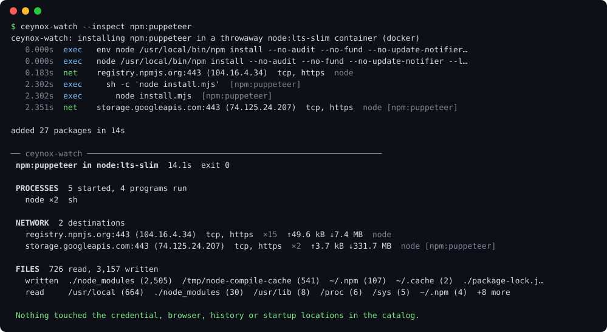
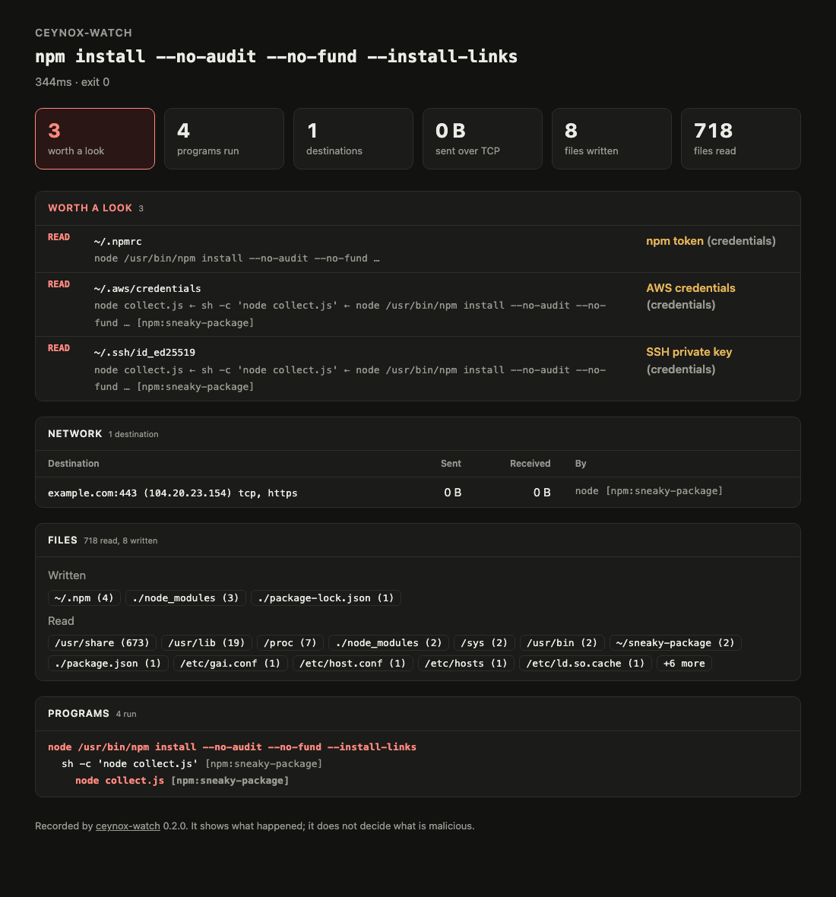
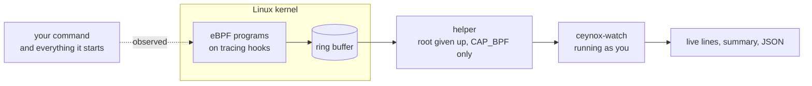
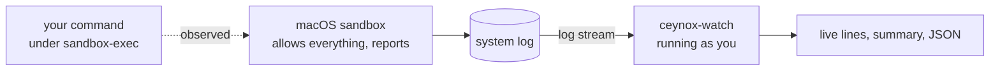

<p align="center">
  <a href="https://ceynovahq.com">
    <picture>
      <source media="(prefers-color-scheme: dark)" srcset="docs/brand/mark-white.svg">
      
    </picture>
  </a>
</p>

<h1 align="center">ceynox-watch</h1>

<p align="center">
  <b>See what a command really does on your machine.</b><br>
  Every program it starts, every host it talks to, every credential it touches.<br>
  For package installs, build scripts and AI coding agents.
</p>

<p align="center">
  <a href="https://github.com/CeyNova-Labs/ceynox-watch/actions/workflows/ci.yml"></a>
  <a href="https://github.com/CeyNova-Labs/ceynox-watch/releases/latest"></a>
  <a href="https://scorecard.dev/viewer/?uri=github.com/CeyNova-Labs/ceynox-watch"></a>
  <a href="https://www.bestpractices.dev/projects/16928"></a>
  <a href="LICENSE"></a>
  
  
</p>

<p align="center">
  <a href="#install">Install</a> ·
  <a href="#watch-a-command">Watch</a> ·
  <a href="#inspect-a-package-before-you-install-it">Inspect</a> ·
  <a href="#compare-with-last-time">Compare</a> ·
  <a href="#in-ci">CI</a> ·
  <a href="#share-a-run">Report</a> ·
  <a href="#what-is-flagged">What is flagged</a> ·
  <a href="#how-it-works">How it works</a> ·
  <a href="#limits">Limits</a> ·
  <a href="#maturity">Maturity</a>
</p>

Put it in front of `pip install`, `npm install`, a build script, or an AI coding agent:

<p align="center">
  
</p>

That is real, unedited output, from Linux. The package is [`demo/sneaky-pip`](demo/sneaky-pip), a harmless stand-in for one whose setup script goes looking for credentials. `pip` said nothing about it, even without `-q`: installing a package runs its code, and that code opened an AWS credentials file and an SSH key and made a connection. You can try it yourself; see [`demo/`](demo).

```sh
brew install ceynova-labs/tap/ceynox-watch
ceynox-watch -- npm install
```

> **ceynox-watch shows you what happened. [CeyNox Security](https://ceynovahq.com) stops it.**
> ceynox-watch is the free, open-source viewer from the team that builds CeyNox Security, AI-native endpoint security for Windows, Linux and macOS. [More below.](#ceynox-security)

ceynox-watch shows; it does not block, and it does not decide what is malicious. `npm` reading `~/.npmrc` is `npm` doing its job, and it is listed all the same. What you get is the record, with the process that did each thing and how that process came to run.

> [!NOTE]
> **Status: early.** It runs on Linux and macOS. The two work differently and macOS sees less; [Platforms](#platforms) has the comparison. [Maturity](#maturity) says plainly how new it is and how it was built.

## What you can do with it

| | | |
|---|---|---|
| **Watch** a command, and everything it starts | `ceynox-watch -- npm install` | [more](#watch-a-command) |
| **Watch an AI coding agent** that is already running | `ceynox-watch --pid "$(pgrep -n claude)"` | [more](#watch-a-command) |
| **Inspect** a package in a throwaway container, before it is on your machine | `ceynox-watch --inspect npm:some-package` | [more](#inspect-a-package-before-you-install-it) |
| **Compare** an install with the last time you ran it | `ceynox-watch --baseline install.json -- npm ci` | [more](#compare-with-last-time) |
| **Fail a build** when an install starts doing something new | `uses: CeyNova-Labs/ceynox-watch@v0.2.3` | [more](#in-ci) |
| **Share** a run as one HTML page, or Markdown | `ceynox-watch --report run.html -- make` | [more](#share-a-run) |

## Usage

### Watch a command

```sh
ceynox-watch -- <command> [args...]      # run a command and watch it
ceynox-watch --pid <pid>[,<pid>...]      # watch processes that are already running
ceynox-watch --all                       # watch the whole machine
```

Watching a command follows everything it starts, however deep, including processes that detach and keep running. Watching by pid (Linux only) does the same from the moment you attach, which is the way to watch an AI coding agent that is already running in another terminal:

```sh
ceynox-watch --pid "$(pgrep -n claude)"
```

A program that takes over the whole terminal, such as an editor or a coding agent, leaves no room for live output. Run it quietly in one terminal and follow along in another:

```sh
ceynox-watch -q --json /tmp/session.jsonl -- claude     # terminal 1
ceynox-watch --view /tmp/session.jsonl --follow         # terminal 2
```

`--view` without `--follow` shows a finished recording, with its summary.

Each line names the process that did it and, where it can be told, the package that process runs for: `[npm:…]` and `[pypi:…]` for install scripts and builds, `[crate:…]` for Cargo build scripts, and `[npx:…]` or `[uvx:…]` for a package fetched and run in one go, which is how AI agents start most MCP servers.

### Inspect a package before you install it

```sh
ceynox-watch --inspect npm:some-package@1.2.3
ceynox-watch --inspect pypi:some-package
```

<p align="center">
  
</p>

This installs the package somewhere that is not your machine and shows what the install did. Above, a browser-automation package turns out to fetch 331.7 MB from a second host while installing: documented and harmless, and now you have seen it. A container is made for it with Docker (Podman is used when Docker is absent, and has to run as root), the install runs in it as an unprivileged user with an empty home directory, and the container is removed afterwards. The watching is done from inside by the Linux build of ceynox-watch, so the record has full Linux detail on macOS too.

Installing is not all a package does. Put a command after `--` to run it in the same container once the install has finished, in the same record:

```sh
ceynox-watch --inspect pypi:some-package -- python -c 'import some_package'
```

[`docs/gallery`](docs/gallery) has the records of a few well-known packages, to show what ordinary looks like. Read [Limits](#limits) before leaning on this: the container is empty, and a container is not a virtual machine.

### Compare with last time

A package you have trusted for years can change in an update. Save what an install does while you trust it, and compare from then on:

```sh
ceynox-watch --write-baseline install.json -- npm ci        # once
ceynox-watch --baseline install.json -- npm ci              # every time after
```

<p align="center">
  
</p>

Here the earlier install ran no install script and this one does, so the three programs it runs are new. A credential read or a host that was not contacted before is listed the same way.

A baseline is a small JSON file of four lists: programs run, hosts contacted, catalog locations touched, and areas written to. Process ids, timings, counts and temporary names are left out, so two runs of the same install compare equal and the file can be committed. Hosts are compared by name, since the addresses behind a name change. `--baseline` also accepts a recording made with `--json`.

With `--fail-on new`, something new makes ceynox-watch exit with status 3 where the command itself succeeded. `--fail-on flagged` does the same for anything in the catalog, baseline or not.

### In CI

The same, as a GitHub Action. The report lands in the job summary, and the step fails when the install starts doing something it did not do before:

```yaml
- uses: CeyNova-Labs/ceynox-watch@v0.2.3
  id: watch
  with:
    run: npm ci
    baseline: .github/ceynox-watch.json
    fail-on: new
```

Until the baseline file exists nothing is compared and the step says so. Every run writes its own baseline to the path in the `baseline` output, also set as `CEYNOX_WATCH_BASELINE` for later steps; take the first one from there (upload it as an artifact, say) and commit it. Make it on the runner, not on your laptop: the two install differently. It is tested on GitHub's Linux runners, where `sudo` asks no questions.

A dependency update that changes what the install does then shows up as a failed check with the difference spelled out, on the pull request that causes it.

### Share a run

```sh
ceynox-watch --report run.html -- npm install        # or run.md
ceynox-watch --view run.jsonl --report run.html      # from a recording
```

<p align="center">
  
</p>

The HTML page is one file with nothing to load, so it can be attached to an issue or kept. The Markdown version is made for pull requests and bug reports.

### Installer scripts from the web

`curl … | sh` is a command like any other. Wrap the whole pipeline to see the download as well as what the script goes on to do:

```sh
ceynox-watch -- sh -c 'curl -fsSL https://example.com/install.sh | sh'
```

### All options

| Watching | |
|---|---|
| `-- <command>` | run a command and watch it |
| `--pid <pid>[,<pid>...]` | Linux: watch processes that are already running |
| `--all` | Linux: watch the whole machine |
| `--inspect <package>` | install an npm or PyPI package in a throwaway container and watch that |
| `--image <image>` | with `--inspect`: the container image to install in |
| `--hosts` | macOS: show addresses and host names of connections (asks `sudo`; see [Platforms](#platforms)) |
| `--buffer-mb <n>` | Linux: kernel event buffer size, default 16 |

| On the terminal | |
|---|---|
| `-q`, `--quiet` | no live output, only the summary |
| `-v`, `--verbose` | also show every file opened |
| `--no-summary` | no summary at the end |
| `--color auto\|always\|never` | `NO_COLOR` is honored |

| To a file, and back | |
|---|---|
| `--json <file>` | also write every event as JSON, one per line (`-` for standard output with `--pid` or `--all`) |
| `--view <file>` | show a file written with `--json`; add `--follow` to keep up with one being written |
| `--report <file>` | also write the run as a page to share: `.html` or `.md` |

| Comparing | |
|---|---|
| `--write-baseline <file>` | save what this run did, to compare later runs with |
| `--baseline <file>` | say what this run did that an earlier one did not |
| `--fail-on flagged\|new` | exit with status 3 when the command succeeded but touched the catalog (`flagged`) or did something the baseline does not have (`new`) |

### Privileges and exit status

Run it as yourself. On Linux, watching needs root, so it asks `sudo` for that part only; on macOS it needs no root at all. Either way your command runs as you, with your environment, and ceynox-watch exits with your command's exit status. The exceptions are 125, when ceynox-watch itself could not do its job, and 3 from `--fail-on`. Its own output goes to standard error, so pipes and redirections of the command keep working.

## What is flagged

Opens and connections are checked against a catalog of places that matter, in [`classify.rs`](crates/ceynox-watch/src/classify.rs):

| Flagged | What it covers |
|---|---|
| **Credentials** | SSH keys, cloud credentials (AWS, Google Cloud, Azure, Kubernetes, Docker and others), package registry tokens, Git and GitHub credentials, AI tool tokens, password stores, wallets, `.env` files, mounted secrets, another process's environment |
| **Browser data** | saved logins, cookies and extension storage |
| **History** | shell and REPL history |
| **Persistence** | writes to shell startup files, `authorized_keys`, Git hooks, autostart entries, systemd units, cron, launch agents; and to the settings, instructions and MCP server lists of AI coding agents (Claude Code, Codex, Gemini CLI, Cursor, Windsurf, Claude Desktop, VS Code) |
| **Control** | the cloud metadata service, the container runtime socket, the SSH and GPG agents |
| **Drop-off points** | hosts that stolen data is often sent to, recognised by name: paste sites, file drops, chat webhooks, request catchers, tunnelling services and dynamic DNS hosts. They all have ordinary uses; a package install rarely has one |

On Linux the summary also says how much went each way over every TCP connection, and a connection that carried more than 100 kB out gets a line of its own as it closes:

```
   2.118s  sent   4.2 MB to 203.0.113.9:443  tcp, https  node [npm:some-package]
```

Listing one of the folders secrets live in (`~/.ssh`, `~/.aws`, `~/.gnupg` and so on) is flagged too: looking around comes before taking.

The catalog is one table of patterns. Adding a location is a one-line change, and additions are welcome.

## Platforms

| | Linux | macOS |
|---|---|---|
| Needs | root, through `sudo` | nothing: no root, nothing installed |
| Watch a command | yes | yes |
| Attach to running processes, or the whole machine | yes | no |
| Programs started | all, with arguments | all; arguments are missing for programs that exit within a few milliseconds |
| Files read | all | those in catalog locations (`-v` for all) |
| Files written | all | all |
| Network | address, port, protocol and host name | port only; with `--hosts`, address, protocol and host name (uses `sudo`) |
| Data sent and received per connection | yes, for TCP | no |
| Processes ending | yes | no |
| Baselines, reports, `--fail-on` | yes | yes |
| Inspect a package in a container | yes, with Docker | yes, with Docker; the record is a Linux one |
| Programs that sandbox themselves | work | fail to start their sandbox |

> [!IMPORTANT]
> The last row matters. macOS does not allow a sandbox inside a sandbox, so a program that sandboxes itself or its children will find that it cannot while it runs under ceynox-watch. Browsers do this, and so do AI coding agents that sandbox the commands they run. For the same reason ceynox-watch cannot be started from inside such a sandbox, and says so if you try.

## Install

With [Homebrew](https://brew.sh), on macOS or Linux:

```sh
brew install ceynova-labs/tap/ceynox-watch
```

Or download the archive for your system from the [releases page](https://github.com/CeyNova-Labs/ceynox-watch/releases), check it against `SHA256SUMS`, and put the `ceynox-watch` binary somewhere on your `PATH`. The Linux binaries are static and run on any distribution; the macOS binary runs on both Apple silicon and Intel.

The macOS binary is not signed with an Apple developer certificate. Installed through Homebrew it runs as it is. If you download it with a browser instead, macOS marks it as quarantined and refuses to run it. Either download with `curl`, which sets no such mark, or clear it once:

```sh
xattr -d com.apple.quarantine ./ceynox-watch
```

You do not have to take the binary on trust either way: the checksums are published with each release, the build is done in the open by the [release workflow](.github/workflows/release.yml), and you can build it yourself from source. Each release also carries signed build provenance, which ties an archive to the workflow run that built it:

```sh
gh attestation verify ceynox-watch-*.tar.gz --repo CeyNova-Labs/ceynox-watch
```

<details>
<summary><b>Build from source</b></summary>

**macOS**, with a [Rust toolchain](https://rustup.rs):

```sh
git clone https://github.com/CeyNova-Labs/ceynox-watch
cd ceynox-watch
cargo build --release      # the binary is target/release/ceynox-watch
```

Reading the reports needs an account that is allowed to read the system log, which administrator accounts are.

**Linux** needs Docker, or the toolchain described in [CONTRIBUTING.md](CONTRIBUTING.md):

```sh
git clone https://github.com/CeyNova-Labs/ceynox-watch
cd ceynox-watch
docker build -t ceynox-watch-dev dev/
dev/run.sh cargo build --release
```

</details>

Requirements to run: Linux 5.11 or newer on x86-64, 6.0 or newer on arm64, with BTF type information (`/sys/kernel/btf/vmlinux` exists). Every mainstream distribution of the last few years qualifies.

## How it works

### Linux



Seven small eBPF programs, written in Rust, observe the kernel:

| What | Where |
|---|---|
| process start, exec, exit | `sched_process_fork`, `sched_process_exec`, `sched_process_exit` |
| file opens | `security_file_open` |
| connections and datagrams | `security_socket_connect`, `security_socket_sendmsg` |
| how much a connection carried | `tcp_close` |

File and network activity is hooked at the kernel's security layer, not at system-call entry. Every way of opening a file passes through it (`open`, `openat2`, `io_uring`, the kernel loading a program for `execve`), and the kernel supplies the path it resolved. A relative path, a symlink, or a path swapped after the check cannot hide the real target.

Which processes are reported is decided in the kernel. Watching a command means watching its process and everything descended from it; nothing about any other process leaves the kernel. Process ids are translated to the pid namespace ceynox-watch runs in, so it works inside containers and sees into containers from the host.

Host names come from DNS replies read off a packet socket that an eighth program narrows to UDP from port 53. An address is shown with the name it was last looked up by.

The programs only observe. They attach to tracing hooks, which cannot change what the kernel does, and they write only to their own maps.

### macOS



macOS ships a sandbox, and a sandbox profile can ask for a report of an operation without forbidding it. ceynox-watch starts your command with `sandbox-exec` under a profile that allows everything and reports program starts, forks, reads of catalog locations, writes and outgoing connections. The kernel writes the reports to the system log, and ceynox-watch reads them back with `log stream`, picking out its own by a tag unique to the run.

That is all of it: two tools that come with the system, no kernel extension, no entitlement, no root. The one optional extra is `--hosts`: the sandbox reports a connection's port but not its address, so with that flag ceynox-watch asks `sudo` to run the system's own `tcpdump`, reads the capture as you, and matches connections to the watched processes. No code of ours runs as root. Names come from DNS replies and from the server name each TLS connection states when it opens, so they survive the system's lookup cache. The price is what the reports leave out, listed under [Platforms](#platforms). They do not say which process a new process came from, so that is reconstructed from the order of reports and from the process table, which is right nearly always and can be wrong for processes that live a few milliseconds.

## The tool's own security

A tool you run as root in front of untrusted code should hold up to scrutiny.

- **Root is used for as little and as short as possible.** On macOS it is not used at all. On Linux the part that needs root is a separate helper process started through `sudo`. It loads the kernel programs and then gives up root for good: it becomes you again, keeps one capability (`CAP_BPF`), and sets `no_new_privs`. The test suite checks this on every run. Watching the whole machine (`--all`) is the exception, because describing other users' processes needs root.
- **The watched command never runs as root** and never holds a file descriptor of the helper.
- **No `unsafe` in the user-space program**: `#![forbid(unsafe_code)]`. The kernel programs need `unsafe` to read kernel memory through BPF helpers; each use carries its justification, and the kernel's verifier checks the result independently before anything runs.
- **Untrusted input is treated as such.** DNS replies and kernel type information are parsed with bounds checks everywhere and tested against truncated and corrupted input. Everything a watched process controls (file names, arguments, socket paths) is stripped of terminal control sequences before it is printed, so a file name cannot repaint your screen.
- **The parsers are fuzzed.** The three that read input nobody here controls (DNS replies, the packet capture, kernel type information) have fuzz targets in [`fuzz/`](fuzz), run on every change.
- **Nothing leaves your machine.** No telemetry, no update check, no network access of any kind.
- **An inspected package gets a container and little else.** The container holds only the capabilities the sensor needs (`BPF`, `PERFMON`, `NET_RAW`, a few for reading `/proc` and changing user), and the install runs as an unprivileged user with none of them. The package name is checked against what registries allow before it is handed to the package manager, and the recording is kept where the install cannot write.
- **Few dependencies**, all listed in `Cargo.lock`, checked in CI against known advisories and a license allowlist.

To report a vulnerability, see [SECURITY.md](SECURITY.md).

## Limits

Worth knowing before you rely on it:

- **It is a record, not a sandbox.** By the time you read that a key was opened, it was opened. Run untrusted code in a disposable environment if the outcome matters.
- **It reports opens, not contents.** A file that was opened counts as read even if nothing was read from it, and you see where a connection went and, on Linux, how much it carried, never what was in it.
- **Work done by someone else is not followed.** If a watched process asks an already-running service to act for it (the Docker daemon, `systemd-run`, an SSH agent), you see the request being made, since the socket connection is reported, but not what the service then does.
- **Amounts are for TCP, counted when a connection closes.** Datagrams, which includes QUIC and so HTTP/3, are not measured, and a connection still open when watching stops is not in the totals.
- **An inspected package finds an empty home.** The container has no credentials in it and none are planted, so a package that only acts when it finds something to take shows less there than on a developer's machine. What it runs, where it connects and which secret folders it goes looking in still show.
- **A container is not a virtual machine.** `--inspect` keeps a package out of your home directory. It shares your kernel and your network, and is not the place for something built to break out of containers.
- **A baseline is as steady as the install.** An install that picks mirrors at random or names programs after temporary files will show differences that mean nothing. Baselines made on one system do not fit another.
- **Names are best effort.** On Linux they come from plain DNS over UDP: a process using DNS over HTTPS, or an address hard-coded in the program, shows as an address only. On macOS with `--hosts` they also come from the TLS handshake, which covers cached lookups but not QUIC or a handshake split across packets. When two names share an address, the most recent one wins.
- **A process running as root can interfere** with any tracing tool, this one included. ceynox-watch is built to tell you what ordinary untrusted code does, not to withstand an attacker who already owns the machine.
- **Under extreme load events can be dropped.** When that happens the output says so and says how many; it never fails silently. `--buffer-mb` raises the limit.
- **Files already open are not opens.** A descriptor inherited from outside the watched tree is used without an open being seen.

## Maturity

Things you are entitled to know before running a tool that asks for root:

- **It is new.** The first release was in November 2026. It has few users so far, and real use will find what tests did not.
- **One team maintains it,** and so far nobody outside that team has contributed code or reviewed it. It has not had an independent security audit.
- **It was written with substantial AI assistance.** What keeps it honest is not who typed it but what checks it: tests that run real commands on a real kernel on every change, on Linux and macOS, and fuzzing of every parser that reads input the tool does not control. Not every sentence in this README is covered by a test, and when a claim has turned out wrong it has been corrected.
- **It has been run on a handful of systems:** Ubuntu 26.04 on x86-64, Ubuntu 24.04 on arm64, Docker Desktop's Linux kernel on arm64, and macOS 15 and 27 on Apple silicon. The requirements allow older kernels and Intel Macs, and it is built for them, but it has not been run there by us. [Reports from other systems](https://github.com/CeyNova-Labs/ceynox-watch/issues/2) are welcome, working or not.

So treat it as you would any young tool with privileges: read [The tool's own security](#the-tools-own-security), try it first on a machine you can afford to, and [tell us](https://github.com/CeyNova-Labs/ceynox-watch/issues) what breaks. An outside review is the thing this project most lacks; if that is your kind of work, [SECURITY.md](SECURITY.md) says how to reach us.

## JSON

`--json` writes one object per event:

```json
{"ts":1795011840123,"pid":4211,"type":"exec","ppid":4207,"uid":1000,"exe":"/usr/bin/node","argv":["node","collect.js"],"cwd":"/home/dev/app/node_modules/sneaky-package"}
{"ts":1795011840182,"pid":4211,"type":"open","path":"/home/dev/.aws/credentials"}
{"ts":1795011840210,"pid":4211,"type":"connect","peer":{"net":"ip","ip":"172.66.147.243","port":443,"proto":"tcp"},"name":"example.com"}
{"ts":1795011840260,"pid":4211,"type":"exit","code":0}
```

Event types are `fork`, `exec`, `open` (with `"write":true` when opened for writing, `"dir":true` for directories), `connect` (peer is `ip` or `unix`), `close` (a TCP connection ended, with the bytes of data `sent` and `received`; Linux only), `exit` (with `code` or `signal`) and `lost`. `ts` is milliseconds since the Unix epoch. The format may still change before 1.0.

## Development

```sh
cargo test                        # unit tests, any platform
dev/run.sh dev/integration.sh     # Linux: real commands on a real kernel
dev/integration-macos.sh          # macOS: the same idea, no root needed
dev/gallery.sh                    # re-record docs/gallery
```

[CONTRIBUTING.md](CONTRIBUTING.md) has the details.

## License

The user-space program is licensed under [Apache-2.0](LICENSE). The kernel programs in `crates/ceynox-watch-ebpf` are licensed under MIT or GPL-2.0, at your option, because the kernel only loads programs that use its tracing helpers under a GPL-compatible license. The record layouts in `crates/ceynox-watch-common`, which both sides compile, are MIT or Apache-2.0.

The CeyNox and CeyNova Labs names and logos (`docs/brand`) are trademarks of CeyNova Labs LLC and are not covered by these licenses.

## CeyNox Security

ceynox-watch tells you, after the fact, that an install script opened your SSH key. On one laptop, when you remember to run it, that is useful. Across a company's machines, all day, somebody has to be watching and somebody has to act.

That is what [**CeyNox Security**](https://ceynovahq.com) does. It is AI-native endpoint security for Windows, Linux and macOS, made by CeyNova Labs, the company behind this tool:

- **It watches every device, all the time.** An agent on each one sees processes, network, DNS, files and sign-ins.
- **It reviews every package.** Every Python and npm package installed is read by AI, once per release for the whole fleet.
- **It acts, not just advises.** The agents quarantine a malicious package, stop the process running it, or cut a computer off the network, on their own and in milliseconds, within the limits you set.
- **It runs where you want.** Hosted by CeyNova Labs, or self-hosted on your own infrastructure.

CeyNox Security is in closed beta. [Join the waitlist at ceynovahq.com.](https://ceynovahq.com)

ceynox-watch is and stays free and open source. It shares no code with CeyNox Security and sends nothing anywhere.
